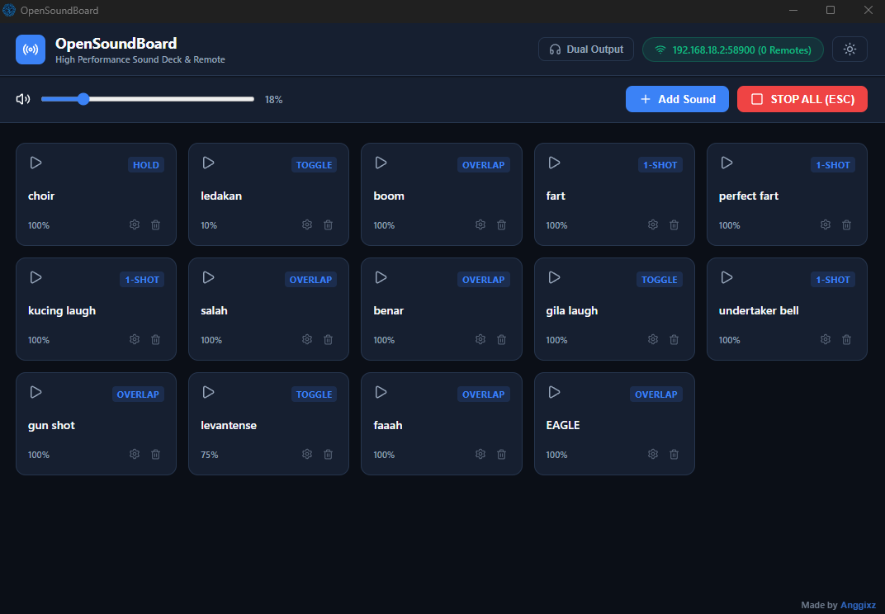
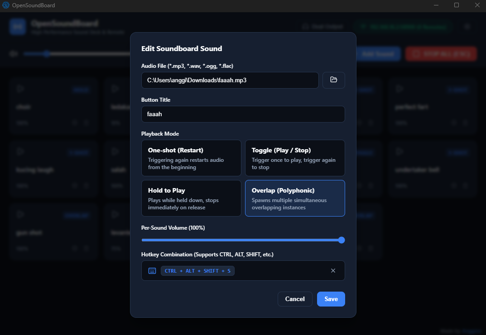
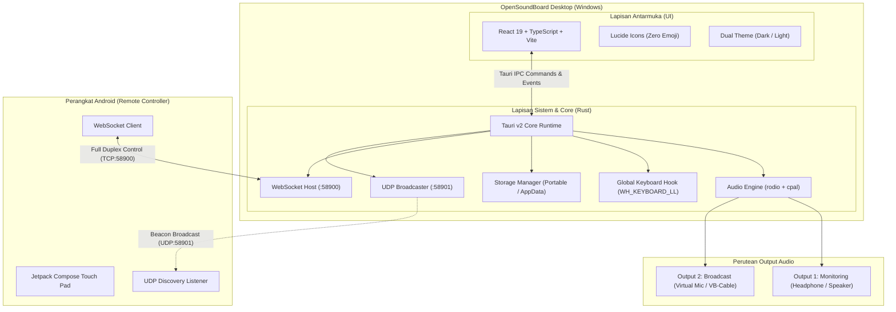

# OpenSoundBoard - Desktop Core & Remote Server

> **Pilih Bahasa / Language:** **[English](README.md)** | **Bahasa Indonesia**
>
> Jika ingin mengontrol soundboard ini melalui perangkat Android via Wi-Fi lokal, kunjungi repositori Android client: **[OpenSoundBoard-Remote](https://github.com/anggixz/OpenSoundBoard-Remote)**.

OpenSoundBoard Desktop adalah aplikasi soundboard native untuk Windows 10 dan 11 yang dirancang untuk performa tinggi, pemutaran audio berlatensi rendah (< 10 ms), perutean audio ganda (*dual routing*), dan kendali jarak jauh melalui aplikasi Android via jaringan lokal (Wi-Fi).

Aplikasi dibangun menggunakan arsitektur hybrid **Tauri v2 (Rust)** pada lapisan sistem dan **React 19 + TypeScript + Vite** pada antarmuka pengguna.

---

## Preview





---

## Daftar Isi
- [Preview](#preview)
- [Arsitektur & Komponen Utama](#arsitektur--komponen-utama)
- [Spesifikasi Fitur](#spesifikasi-fitur)
  - [1. Audio Engine & Dual Routing](#1-audio-engine--dual-routing)
  - [2. Sistem Hotkey Global](#2-sistem-hotkey-global)
  - [3. Local Remote Server & Keamanan](#3-local-remote-server--keamanan)
  - [4. Persistensi Otomatis (Portable & Installer)](#4-persistensi-otomatis-portable--installer)
  - [5. Arsitektur Keamanan Game & Anti-Cheat](#5-arsitektur-keamanan-game--anti-cheat)
- [Struktur Direktori](#struktur-direktori)
- [Prasyarat Sistem](#prasyarat-sistem)
- [Instalasi & Menjalankan Mode Development](#instalasi--menjalankan-mode-development)
- [Kompilasi Biner Rilis (.exe)](#kompilasi-biner-rilis-exe)
- [Protokol Komunikasi Remote (WebSocket & UDP)](#protokol-komunikasi-remote-websocket--udp)
- [Skema File Konfigurasi (config.json)](#skema-file-konfigurasi-configjson)
- [Panduan Pemecahan Masalah (Troubleshooting)](#panduan-pemecahan-masalah-troubleshooting)
- [Lisensi](#lisensi)

---

## Arsitektur & Komponen Utama



---

## Spesifikasi Fitur

### 1. Audio Engine & Dual Routing
- **Format Berkas yang Didukung**: `.mp3`, `.wav`, `.ogg`, `.flac`.
- **4 Mode Pemutaran Audio**:
  - `One-shot`: Audio diputar dari awal. Jika ditekan kembali saat audio masih berputar, audio mengulang dari awal seketika (*stutter effect*).
  - `Toggle`: Tekan untuk memutar; tekan kembali saat audio berputar untuk menghentikannya seketika.
  - `Hold to Play`: Audio berputar secara *infinite loop* mulus selama tombol ditahan. Begitu tombol dilepas, pemutaran langsung berhenti tanpa *stutter*.
  - `Overlap (Polyphonic)`: Setiap penekanan memicu pemutaran *instance* baru tanpa memotong suara yang sedang berjalan.
- **Dual Audio Routing**:
  - **Output 1 (Monitoring)**: Rute ke Headphone / Speaker fisik pribadi. Dilengkapi opsi `Tidak Ada (None / Dinonaktifkan)`.
  - **Output 2 (Broadcast)**: Rute ke Virtual Audio Cable (seperti VB-Cable atau Virtual Audio Cable) untuk diteruskan ke Discord, game, streaming OBS, atau aplikasi rapat. Dilengkapi opsi `Tidak Ada (None / Dinonaktifkan)`.
- **Pengaturan Volume**: Slider volume master global (0% - 100%) dan slider volume mandiri per-audio (0% - 100%).
- **Penggantian File Audio**: File audio pada item soundboard dapat diganti langsung via dialog file tanpa perlu membuat ulang konfigurasi hotkey maupun volumenya.

### 2. Sistem Hotkey Global
- **Pass-Through Input**:
  - Menggunakan Windows Low-Level Keyboard Hook (`WH_KEYBOARD_LL` via Win32 `SetWindowsHookExW` dan `CallNextHookEx`).
  - Penekanan tombol keyboard (seperti `A`, `1`, `CTRL+1`, `ALT+A`) diteruskan 100% ke aplikasi lain yang sedang aktif (Notepad, Word, browser, game, Discord) tanpa memblokir pengetikan normal, sembari mengeksekusi audio soundboard.
- **Kompatibilitas Game Exclusive & Windowed Fullscreen**:
  - Manifes aplikasi Windows telah dikonfigurasi dengan `requireAdministrator` agar integritas proses setara atau melampaui level game (Steam, Riot Vanguard, Easy Anti-Cheat, Battle.net), melewati pembatasan Windows UIPI.
  - Berjalan pada background thread berprioritas tinggi (`THREAD_PRIORITY_HIGHEST`) dengan antrean pekerja non-blocking sehingga hook tidak mengalami *timeout* saat game memakai 100% CPU/GPU.
- **Dual Focus Awareness**:
  - Mendeteksi jendela aktif secara otomatis via `GetWindowThreadProcessId(GetForegroundWindow())`.
  - Saat jendela OpenSoundBoard aktif, listener React DOM menangani penekanan tombol secara instan dengan proteksi input form (mengetik teks di input/modal tidak memicu audio).
  - Saat berada di luar aplikasi (dalam game, Discord, atau desktop), hook global menangani input secara mulus.
- **Tanpa Debounce & Mendukung Spamming Cepat**:
  - Batasan timer debounce dihapus sepenuhnya, memungkinkan spamming tombol super cepat dan instan untuk sound effect.
- **Perekam Hotkey Interaktif**:
  - Mendukung kombinasi modifier dinamis (`Ctrl`, `Alt`, `Shift`, `Win`), tombol fungsi (`F1` - `F24`), dan tombol numpad.
- **Panic Stop**: Tombol `Escape` saat jendela aplikasi aktif menghentikan seluruh audio yang sedang berjalan seketika.

### 3. Local Remote Server & Keamanan
- **WebSocket Server Terintegrasi**: Berjalan di latar belakang menggunakan `tokio-tungstenite`. Menerima perintah pemicuan audio, pengaturan volume, sinkronisasi koleksi suara, dan penghentian pemutaran dari remote Android.
- **Port Server Dinamis (Hot-Reloading)**:
  - Port WebSocket dapat diubah melalui antarmuka pada rentang `1024 - 65535` (Default: `58900`).
  - Backend memvalidasi ketersediaan socket sebelum menerapkan pemindahan port (*re-binding*) secara mulus tanpa perlu merestart aplikasi.
- **Zero-Config UDP Discovery**:
  - Memancarkan beacon berkala di port `58901` ke alamat siaran `255.255.255.255`.
  - Mengumumkan alamat IP host, nomor port WebSocket aktif, dan status kebutuhan password ke klien Android di jaringan Wi-Fi lokal.
- **Keamanan Password Remote (Opsional)**:
  - Akses remote dapat dikunci menggunakan password kustom.
  - Klien Android yang belum terautentikasi akan menerima sinyal `AUTH_REQUIRED` dan seluruh perintah pemicuan audio akan ditolak sampai paket autentikasi yang valid dikirim.

### 4. Persistensi Otomatis (Portable & Installer)
Aplikasi secara cerdas mendeteksi mode instalasi saat dijalankan:
- **Mode Portable**: Jika file biner dijalankan di luar folder `Program Files`, berkas konfigurasi disimpan tepat di samping executable (`config.json`). Seluruh koleksi suara, perangkat audio, nomor port, password, volume, dan tema tersimpan mandiri dalam satu folder (cocok untuk USB Flashdisk).
- **Mode Installer**: Jika aplikasi terpasang di sistem melalui setup wizard, konfigurasi disimpan di direktori data pengguna Windows (`%APPDATA%\OpenSoundBoard\config.json`).
- Setiap perubahan data (tambah/edit suara, ubah rute output, ubah port, atur password) langsung disimpan secara otomatis (*auto-save*) dan dipulihkan kembali saat aplikasi dibuka ulang (*auto-restore*).

### 5. Arsitektur Keamanan Game & Anti-Cheat
OpenSoundBoard dirancang 100% aman untuk dijalankan bersamaan dengan game ber-anti-cheat kernel (Riot Vanguard, Easy Anti-Cheat, BattlEye, Ricochet, Valve VAC):
- **Zero Process Injection**: Sama sekali tidak pernah menyentuh memori proses game (`OpenProcess`, `WriteProcessMemory`, `VirtualAllocEx`) atau menyuntikkan DLL asing.
- **API Resmi Out-of-Process**: Menggunakan API standar Microsoft Win32 `WH_KEYBOARD_LL` (metode yang sama persis digunakan oleh Discord, Soundpad, OBS Studio, dan Logitech G HUB).
- **Tanpa Makro Sintetis**: Beroperasi sebagai listener pasif; tidak pernah mengirimkan simulasi ketukan tombol palsu (`SendInput`, virtual HID driver, atau recoil compensation script).
- **Murni User-Mode (Ring 3)**: Tidak memuat driver kernel tidak resmi (`.sys`).

---

## Struktur Direktori

```
. (Root Proyek)
├── dist/                     # Hasil kompilasi bundel frontend Vite
├── dist-bin/                 # Lokasi biner final executable Windows
│   ├── installer/            # OpenSoundBoard_1.0.0_x64-setup.exe (NSIS Setup)
│   └── portable/             # OpenSoundBoard.exe (Standalone Portable)
├── public/                   # Aset publik statis (app-icon.png, tauri.svg)
├── scripts/
│   └── build-binaries.js     # Script automasi multi-target build biner
├── src/                      # Source code antarmuka React
│   ├── assets/               # Aset internal antarmuka
│   ├── App.css               # Desain responsif, tema Gelap & Terang
│   ├── App.tsx               # Logika antarmuka utama, modal, audio trigger
│   └── main.tsx              # Entry point aplikasi (blokir context menu)
├── src-tauri/                # Source code backend Rust
│   ├── capabilities/         # Konfigurasi perizinan keamanan Tauri v2
│   ├── icons/                # Berkas multi-resolusi ikon aplikasi (.ico, .png)
│   ├── src/
│   │   ├── audio.rs          # Audio Engine (actor pattern, multi-sink, cpal/rodio)
│   │   ├── hotkey.rs         # Win32 WH_KEYBOARD_LL pass-through global hook
│   │   ├── lib.rs            # Tauri command dispatcher & state container
│   │   ├── main.rs           # Entry point executable
│   │   ├── models.rs         # Struktur data serde (SoundItem, AppConfig, dll.)
│   │   ├── server.rs         # WebSocket host & UDP auto-discovery beacon
│   │   └── storage.rs        # Deteksi path portabilitas & IO config.json
│   ├── build.rs              # Build script kompilasi PE Windows Resource & requireAdministrator manifest
│   ├── Cargo.toml            # Dependensi Rust (rodio, tokio, windows-sys, dll.)
│   └── tauri.conf.json       # Konfigurasi bundler, ukuran window, dan metadata
├── index.html                # Template HTML utama
├── package.json              # Dependensi npm & script eksekusi
├── tsconfig.json             # Konfigurasi TypeScript
└── vite.config.ts            # Konfigurasi bundler Vite
```

---

## Prasyarat Sistem

Untuk mengompilasi proyek dari kode sumber, pastikan lingkungan pengembangan telah terpasang:

1. **Sistem Operasi**: Windows 10 atau Windows 11 (64-bit).
2. **Node.js**: Versi LTS 18.x, 20.x, atau lebih baru.
3. **Rust Toolchain**: Versi stable terbaru (minimal 1.80+), terinstal bersama **Visual Studio C++ Build Tools** (MSVC toolchain).
4. **Microsoft Edge WebView2**: Terpasang bawaan di Windows 10/11.

---

## Instalasi & Menjalankan Mode Development

Jalankan perintah berikut langsung dari direktori root proyek:

1. Pasang seluruh dependensi Node.js:
   ```powershell
   npm install
   ```

2. Jalankan aplikasi dalam mode pengembangan (*Hot Reload Frontend + Rust Recompile*):
   ```powershell
   npm run tauri dev
   ```

---

## Kompilasi Biner Rilis (.exe)

Proyek ini dilengkapi script otomasi build terpadu di [scripts/build-binaries.js](scripts/build-binaries.js).

Jalankan perintah berikut langsung dari direktori root proyek:

```powershell
# Opsi 1: Kompilasi versi PORTABLE saja (.exe mandiri, tanpa instalasi)
npm run build:portable
# Output: dist-bin/portable/OpenSoundBoard.exe (~5.8 MB)

# Opsi 2: Kompilasi versi INSTALLER saja (Setup Wizard NSIS .exe)
npm run build:installer
# Output: dist-bin/installer/OpenSoundBoard_1.0.0_x64-setup.exe (~2.0 MB)

# Opsi 3: Kompilasi KEDUA versi sekaligus secara otomatis
npm run build:all
```

---

## Protokol Komunikasi Remote (WebSocket & UDP)

### 1. UDP Discovery Beacon (Port: `58901`)
Server memancarkan paket broadcast JSON berkala ke `255.255.255.255`:
```json
{
  "service": "OpenSoundBoard",
  "ip": "192.168.x.x",
  "port": 58900,
  "authRequired": true
}
```

### 2. WebSocket Control Packets (Port Default: `58900`)
Komunikasi berbasis JSON teks terstruktur:

- **Autentikasi (Klien -> Server)**:
  ```json
  { "type": "AUTH", "password": "rahasia_anda" }
  ```
- **Respon Autentikasi (Server -> Klien)**:
  `AUTH_REQUIRED`, `AUTH_SUCCESS`, atau `AUTH_FAILED`.
- **Sinkronisasi Koleksi Suara (Server -> Klien)**:
  ```json
  {
    "type": "SYNC",
    "sounds": [
      {
        "id": "snd_abc123",
        "title": "Airhorn",
        "color": "#3B82F6",
        "category": "General",
        "duration_ms": 1500,
        "is_playing": false,
        "volume": 0.8,
        "play_mode": "oneshot"
      }
    ]
  }
  ```
- **Pemicu Audio (Klien -> Server)**:
  ```json
  { "type": "TRIGGER_SOUND", "id": "snd_abc123", "action": "PLAY" }
  ```
  Nilai `action`: `PLAY`, `STOP`, `TOGGLE`, `HOLD_DOWN`, `HOLD_UP`.
- **Pengaturan Master Volume (Klien -> Server)**:
  ```json
  { "type": "SET_VOLUME", "volume": 0.75 }
  ```
- **Panic Stop (Klien -> Server)**:
  ```json
  { "type": "STOP_ALL" }
  ```

---

## Skema File Konfigurasi (config.json)

Berkas `config.json` menyimpan seluruh parameter konfigurasi aplikasi secara persisten:

```json
{
  "sounds": [
    {
      "id": "snd_4876b5c00b0f44e88ad53198a62f8319",
      "title": "Airhorn Sound Effect",
      "path": "C:\\Audio\\airhorn.mp3",
      "hotkey": "CTRL + 1",
      "color": "#3B82F6",
      "category": "General",
      "duration_ms": 0,
      "is_playing": false,
      "volume": 1.0,
      "play_mode": "oneshot"
    }
  ],
  "master_volume": 1.0,
  "server_port": 58900,
  "primary_device": "Headphones (Realtek High Definition Audio)",
  "secondary_device": "CABLE Input (VB-Audio Virtual Cable)",
  "theme": "dark",
  "remote_password": null
}
```

---

## Panduan Pemecahan Masalah (Troubleshooting)

### 1. Audio Tidak Terdengar di Discord atau Game
Pastikan perutean audio ganda telah dikonfigurasi dengan benar:
1. Pasang perangkat virtual mic gratis seperti **VB-Audio Virtual Cable**.
2. Buka dialog **Dual Output** di OpenSoundBoard.
3. Tetapkan **Output 1 (Monitoring)** ke Headphone/Speaker Anda.
4. Tetapkan **Output 2 (Broadcast)** ke `CABLE Input (VB-Audio Virtual Cable)`.
5. Di pengaturan suara Discord / Game, tetapkan Input Device (Microphone) ke `CABLE Output (VB-Audio Virtual Cable)`.

### 2. Remote Android Tidak Menemukan Desktop
- Pastikan HP Android dan PC Desktop terhubung pada satu jaringan Wi-Fi lokal atau segmen subnet yang sama.
- Periksa Windows Firewall: Izinkan OpenSoundBoard untuk berkomunikasi pada jaringan privat (*Private Networks*) untuk port TCP `58900` dan port UDP `58901`.
- Anda juga dapat menggunakan opsi koneksi manual pada dialog remote Android dengan memasukkan alamat IP dan port yang tertera pada badge status desktop.

---

## Lisensi

Proyek ini dilisensikan di bawah **GNU Affero General Public License v3.0 (GNU AGPLv3)**. Lihat berkas [LICENSE](LICENSE) untuk informasi selengkapnya.
