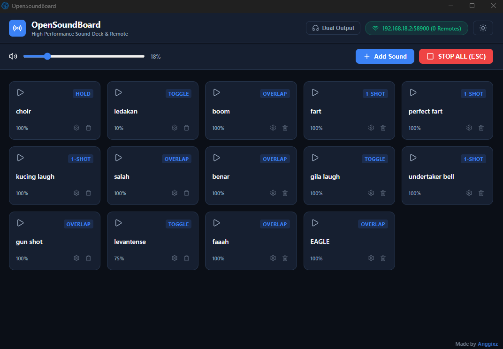
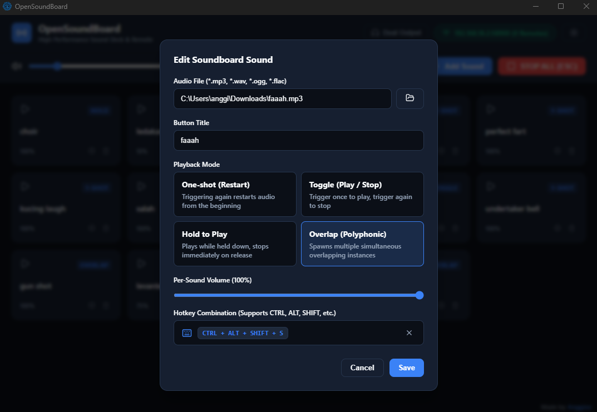
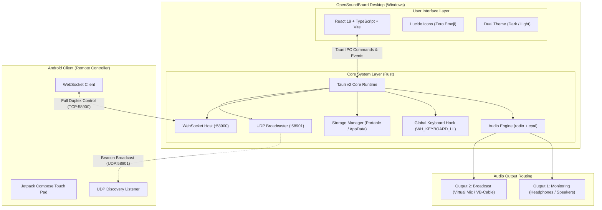

# OpenSoundBoard - Desktop Core & Remote Server

> **Language / Bahasa:** **English** | **[Bahasa Indonesia](README.id.md)**
>
> To control this soundboard remotely from your Android device over local Wi-Fi, visit the Android client repository: **[OpenSoundBoard-Remote](https://github.com/anggixz/OpenSoundBoard-Remote)**.

OpenSoundBoard Desktop is a high-performance native soundboard application for Windows 10 and 11 engineered for low latency (< 10 ms), dual audio routing, and real-time remote control via an Android client app over local Wi-Fi.

The application is built on a hybrid architecture leveraging **Tauri v2 (Rust)** on the system core layer and **React 19 + TypeScript + Vite** on the user interface layer.

---

## Preview





---

## Table of Contents
- [Preview](#preview)
- [Architecture & Core Components](#architecture--core-components)
- [Feature Specifications](#feature-specifications)
  - [1. Audio Engine & Dual Routing](#1-audio-engine--dual-routing)
  - [2. Global Hotkey System](#2-global-hotkey-system)
  - [3. Local Remote Server & Security](#3-local-remote-server--security)
  - [4. Automatic Persistence (Portable & Installer)](#4-automatic-persistence-portable--installer)
  - [5. Anti-Cheat & Game Security Architecture](#5-anti-cheat--game-security-architecture)
- [Directory Structure](#directory-structure)
- [System Prerequisites](#system-prerequisites)
- [Installation & Running Development Mode](#installation--running-development-mode)
- [Building Release Binaries (.exe)](#building-release-binaries-exe)
- [Remote Communication Protocol (WebSocket & UDP)](#remote-communication-protocol-websocket--udp)
- [Configuration Schema (config.json)](#configuration-schema-configjson)
- [Troubleshooting Guide](#troubleshooting-guide)
- [License](#license)

---

## Architecture & Core Components



---

## Feature Specifications

### 1. Audio Engine & Dual Routing
- **Supported Audio Formats**: `.mp3`, `.wav`, `.ogg`, `.flac`.
- **4 Playback Modes**:
  - `One-shot`: Audio plays from the beginning. Triggering again restarts immediately from the start (stutter effect).
  - `Toggle`: Trigger once to play; trigger again while playing to stop immediately.
  - `Hold to Play`: Audio loops continuously without interruption while the key is held down. Releasing the key stops playback instantly without stutter.
  - `Overlap (Polyphonic)`: Each trigger spawns a new playback instance concurrently without cutting off existing sound instances.
- **Dual Audio Routing**:
  - **Output 1 (Monitoring)**: Route to private physical headphones or speakers. Includes an explicit `None / Disabled` option.
  - **Output 2 (Broadcast)**: Route to a Virtual Audio Cable (e.g., VB-Audio Virtual Cable) to feed Discord, in-game voice chat, OBS, or meeting applications. Includes an explicit `None / Disabled` option.
- **Volume Controls**: Master volume slider (0% - 100%) and independent per-sound volume sliders (0% - 100%).
- **In-Place Audio File Replacement**: Change audio files directly via native file dialog without recreating hotkey bindings or volume settings.

### 2. Global Hotkey System
- **Pass-Through Input**:
  - Powered by a Windows Low-Level Keyboard Hook (`WH_KEYBOARD_LL` via Win32 `SetWindowsHookExW` and `CallNextHookEx`).
  - Keystrokes (e.g., `A`, `1`, `CTRL+1`, `ALT+A`) pass through 100% to external apps (Notepad, Word, Discord, games) without being swallowed or blocked.
- **Exclusive & Windowed Fullscreen Game Compatibility**:
  - Embedded Windows application manifest with `requireAdministrator` execution level matches or exceeds game elevation (Steam, Riot Vanguard, Easy Anti-Cheat, Battle.net), bypassing Windows UIPI hook blocks.
  - Runs on a high-priority background thread (`THREAD_PRIORITY_HIGHEST`) with a non-blocking worker queue to prevent hook timeouts under 100% GPU/CPU load.
- **Dual Focus Awareness**:
  - Automatically detects the active foreground window via `GetWindowThreadProcessId(GetForegroundWindow())`.
  - When focused inside OpenSoundBoard, the React DOM key listener handles inputs instantly with form input protection (typing in text boxes or modals will not trigger sounds).
  - When outside the app (in games, Discord, or desktop), the global hook takes over seamlessly.
- **Zero-Debounce Rapid Spamming**:
  - Debounce timers have been removed entirely, enabling ultra-fast, responsive rapid-fire spamming for sound effects.
- **Interactive Hotkey Recorder**:
  - Supports dynamic modifiers (`Ctrl`, `Alt`, `Shift`, `Win`) combined with standard keys, function keys (`F1` - `F24`), and numpad keys.
- **Panic Stop**: Pressing `Escape` while the app window is focused stops all active audio playback instantly.

### 3. Local Remote Server & Security
- **Integrated WebSocket Server**: Runs in the background powered by `tokio-tungstenite`. Handles sound triggering, volume adjustments, soundboard sync, and stop commands from Android clients.
- **Dynamic Port Configuration (Hot-Reloading)**:
  - WebSocket port can be changed in the UI between `1024 - 65535` (Default: `58900`).
  - The backend validates socket availability before rebinding seamlessly without restarting the application.
- **Zero-Config UDP Discovery**:
  - Broadcasts periodic beacon packets on port `58901` to `255.255.255.255`.
  - Automatically announces host IP, active WebSocket port, and authentication status to Android clients on the local Wi-Fi network.
- **Optional Remote Password Security**:
  - Secure remote control access using a custom password.
  - Unauthenticated Android clients receive `AUTH_REQUIRED` and all sound triggers are rejected until a valid authentication packet is received.

### 4. Automatic Persistence (Portable & Installer)
The application automatically detects its execution mode:
- **Portable Mode**: When executed outside `Program Files`, configuration is saved directly next to the executable (`config.json`). Entire sound collections, audio device selections, server port, password, volume, and theme are self-contained (ideal for USB drives).
- **Installer Mode**: When installed via the setup wizard, configuration is stored in the Windows user application data directory (`%APPDATA%\OpenSoundBoard\config.json`).
- Changes (adding/editing sounds, changing audio routes, updating port, setting passwords) are saved automatically (*auto-save*) and restored upon relaunch (*auto-restore*).

### 5. Anti-Cheat & Game Security Architecture
OpenSoundBoard is engineered to be 100% safe to run alongside competitive kernel anti-cheats (Riot Vanguard, Easy Anti-Cheat, BattlEye, Ricochet, Valve VAC):
- **Zero Process Injection**: Never accesses game memory (`OpenProcess`, `WriteProcessMemory`, `VirtualAllocEx`) or injects DLLs into foreign processes.
- **Official Out-of-Process API**: Uses standard Microsoft Win32 `WH_KEYBOARD_LL` (the exact same method used by Discord, Soundpad, OBS Studio, and Logitech G HUB).
- **No Synthetic Macro Input**: Operates as a passive listener; never injects simulated keystrokes (`SendInput`, virtual HID drivers, or recoil compensation scripts).
- **Pure User-Mode (Ring 3)**: Contains no unsigned or third-party kernel drivers (`.sys`).

---

## Directory Structure

```
. (Project Root)
├── dist/                     # Compiled Vite frontend assets
├── dist-bin/                 # Output Windows executable binaries
│   ├── installer/            # OpenSoundBoard_1.0.0_x64-setup.exe (NSIS Setup)
│   └── portable/             # OpenSoundBoard.exe (Standalone Portable)
├── public/                   # Static public assets (app-icon.png, tauri.svg)
├── scripts/
│   └── build-binaries.js     # Multi-target binary build automation script
├── src/                      # React frontend source code
│   ├── assets/               # Internal UI assets
│   ├── App.css               # Responsive styling, Dark & Light themes
│   ├── App.tsx               # Main UI logic, dialogs, audio trigger bindings
│   └── main.tsx              # Application entry point (context menu disabled)
├── src-tauri/                # Rust backend core source code
│   ├── capabilities/         # Tauri v2 security capabilities configuration
│   ├── icons/                # Multi-resolution application icons (.ico, .png)
│   ├── src/
│   │   ├── audio.rs          # Audio Engine (actor pattern, multi-sink, cpal/rodio)
│   │   ├── hotkey.rs         # Win32 WH_KEYBOARD_LL pass-through global hook
│   │   ├── lib.rs            # Tauri command handlers & state container
│   │   ├── main.rs           # Executable entry point
│   │   ├── models.rs         # Serde data models (SoundItem, AppConfig, etc.)
│   │   ├── server.rs         # WebSocket host & UDP auto-discovery beacon
│   │   └── storage.rs        # Portability path detection & config.json IO
│   ├── build.rs              # PE Windows Resource & requireAdministrator manifest
│   ├── Cargo.toml            # Rust dependencies (rodio, tokio, windows-sys, etc.)
│   └── tauri.conf.json       # Tauri bundler configuration, window size, metadata
├── index.html                # Main HTML template
├── package.json              # npm dependencies & run scripts
├── tsconfig.json             # TypeScript configuration
└── vite.config.ts            # Vite bundler configuration
```

---

## System Prerequisites

To build the project from source, ensure the following are installed:

1. **Operating System**: Windows 10 or Windows 11 (64-bit).
2. **Node.js**: LTS version 18.x, 20.x, or newer.
3. **Rust Toolchain**: Latest stable release (1.80+), installed with **Visual Studio C++ Build Tools** (MSVC toolchain).
4. **Microsoft Edge WebView2**: Pre-installed on Windows 10/11.

---

## Installation & Running Development Mode

Execute the following commands from the project root directory:

1. Install Node.js dependencies:
   ```powershell
   npm install
   ```

2. Run the application in development mode (*Hot Reload Frontend + Rust Recompile*):
   ```powershell
   npm run tauri dev
   ```

---

## Building Release Binaries (.exe)

This project includes an automated multi-target build script at [scripts/build-binaries.js](scripts/build-binaries.js).

Execute the following commands from the project root directory:

```powershell
# Option 1: Build PORTABLE binary only (Standalone .exe, no installation required)
npm run build:portable
# Output: dist-bin/portable/OpenSoundBoard.exe (~5.8 MB)

# Option 2: Build INSTALLER binary only (NSIS Setup Wizard .exe)
npm run build:installer
# Output: dist-bin/installer/OpenSoundBoard_1.0.0_x64-setup.exe (~2.0 MB)

# Option 3: Build BOTH binaries concurrently
npm run build:all
```

---

## Remote Communication Protocol (WebSocket & UDP)

### 1. UDP Discovery Beacon (Port: `58901`)
The server broadcasts periodic JSON beacons to `255.255.255.255`:
```json
{
  "service": "OpenSoundBoard",
  "ip": "192.168.x.x",
  "port": 58900,
  "authRequired": true
}
```

### 2. WebSocket Control Packets (Default Port: `58900`)
Structured JSON text protocol:

- **Authentication (Client -> Server)**:
  ```json
  { "type": "AUTH", "password": "your_password" }
  ```
- **Authentication Response (Server -> Client)**:
  `AUTH_REQUIRED`, `AUTH_SUCCESS`, or `AUTH_FAILED`.
- **Sound Collection Sync (Server -> Client)**:
  ```json
  {
    "type": "SYNC",
    "sounds": [
      {
        "id": "snd_abc123",
        "title": "Airhorn",
        "color": "#3B82F6",
        "category": "General",
        "duration_ms": 1500,
        "is_playing": false,
        "volume": 0.8,
        "play_mode": "oneshot"
      }
    ]
  }
  ```
- **Trigger Sound (Client -> Server)**:
  ```json
  { "type": "TRIGGER_SOUND", "id": "snd_abc123", "action": "PLAY" }
  ```
  Allowed `action` values: `PLAY`, `STOP`, `TOGGLE`, `HOLD_DOWN`, `HOLD_UP`.
- **Set Master Volume (Client -> Server)**:
  ```json
  { "type": "SET_VOLUME", "volume": 0.75 }
  ```
- **Panic Stop (Client -> Server)**:
  ```json
  { "type": "STOP_ALL" }
  ```

---

## Configuration Schema (config.json)

The `config.json` file persists all application settings:

```json
{
  "sounds": [
    {
      "id": "snd_4876b5c00b0f44e88ad53198a62f8319",
      "title": "Airhorn Sound Effect",
      "path": "C:\\Audio\\airhorn.mp3",
      "hotkey": "CTRL + 1",
      "color": "#3B82F6",
      "category": "General",
      "duration_ms": 0,
      "is_playing": false,
      "volume": 1.0,
      "play_mode": "oneshot"
    }
  ],
  "master_volume": 1.0,
  "server_port": 58900,
  "primary_device": "Headphones (Realtek High Definition Audio)",
  "secondary_device": "CABLE Input (VB-Audio Virtual Cable)",
  "theme": "dark",
  "remote_password": null
}
```

---

## Troubleshooting Guide

### 1. Audio Not Heard in Discord or Games
Ensure dual audio routing is properly configured:
1. Install a free virtual microphone driver such as **VB-Audio Virtual Cable**.
2. Open the **Dual Output** dialog in OpenSoundBoard.
3. Set **Output 1 (Monitoring)** to your physical Headphones/Speakers.
4. Set **Output 2 (Broadcast)** to `CABLE Input (VB-Audio Virtual Cable)`.
5. In Discord / Game voice settings, set the Input Device (Microphone) to `CABLE Output (VB-Audio Virtual Cable)`.

### 2. Android Remote App Cannot Discover Desktop
- Ensure both the Android smartphone and Desktop PC are connected to the same local Wi-Fi network and subnet.
- Check Windows Defender Firewall: Allow OpenSoundBoard to communicate across Private Networks on TCP port `58900` and UDP port `58901`.
- Alternatively, connect manually via the remote dialog on Android by entering the IP address and port shown on the desktop status badge.

---

## License

This project is licensed under the **GNU Affero General Public License v3.0 (GNU AGPLv3)**. See the [LICENSE](LICENSE) file for details.
